# Proficiency

A Valheim-style skill system for Minecraft. You get better at what you do. Mining raises Mining,
a sword raises Swords, and sneaking past mobs raises Sneaking. You pick no class and fill in no
character sheet. There are 38 skills, each from 0 to 100, and each has a passive, a signature
move, an active ability, a talent tree and five Mastery stars after level 100. Trees link to each
other through 187 synergies. On top of that sits the Hearth, a campfire that a group grows into the
heart of its home.

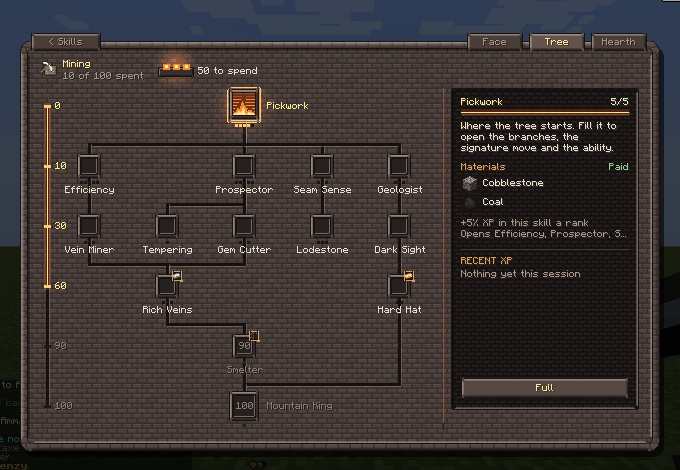

| Jar | Loader | Minecraft | Java |
|---|---|---|---|
| `proficiency-<version>.jar` | NeoForge 21.1.192 or newer | 1.21.1 | 21 |
| `proficiency-<version>-fabric.jar` | Fabric Loader 0.16.14 or newer | 1.21.1 | 21 |
| `proficiency-<version>-forge-1.20.1.jar` | Forge 47.4.0 or newer | 1.20.1 | 17 |

Downloads: [GitHub releases](https://github.com/Purely-Imaginary/proficiency/releases) and
[Modrinth](https://modrinth.com/mod/proficiency-skills). Every change is in
[CHANGELOG.md](CHANGELOG.md).

## Skills and talent trees

The skills key opens the Skillstone, a carved slab with nine category runes around a fire well.
Each rune glows with its category's average level, and a slate lists its skills. Ember marks show
where a talent rank is ready to take.

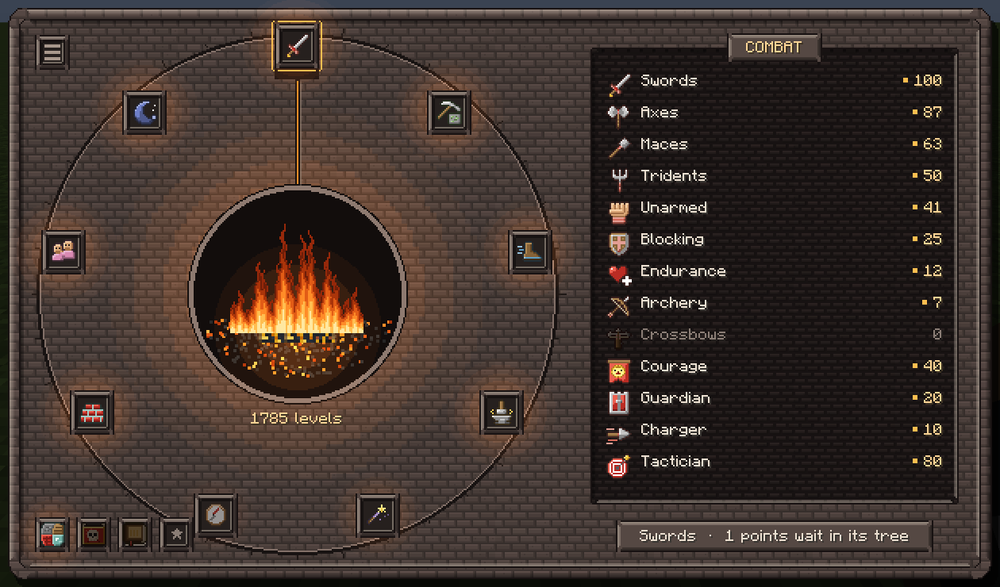

- **The Face.** Click a skill to see its passive, signature move, ability, Mastery rider,
  synergies and records on one stone. At small GUI sizes the Face is one scrolling column.
- **The Tree.** One talent point per level. Every tree fills completely by level 100, so a branch
  sets priority, never a lockout. Click for one rank, Shift-click to fill a node. Some nodes also
  ask for materials, which the node detail lists with what you have.
- **The unlock slam.** The first node wakes the signature move (and the ability from level 50).
  The socket rises, the paid materials fly in, and the card slams into the Face.
- **Respec** costs 1 XP level per 10 points.

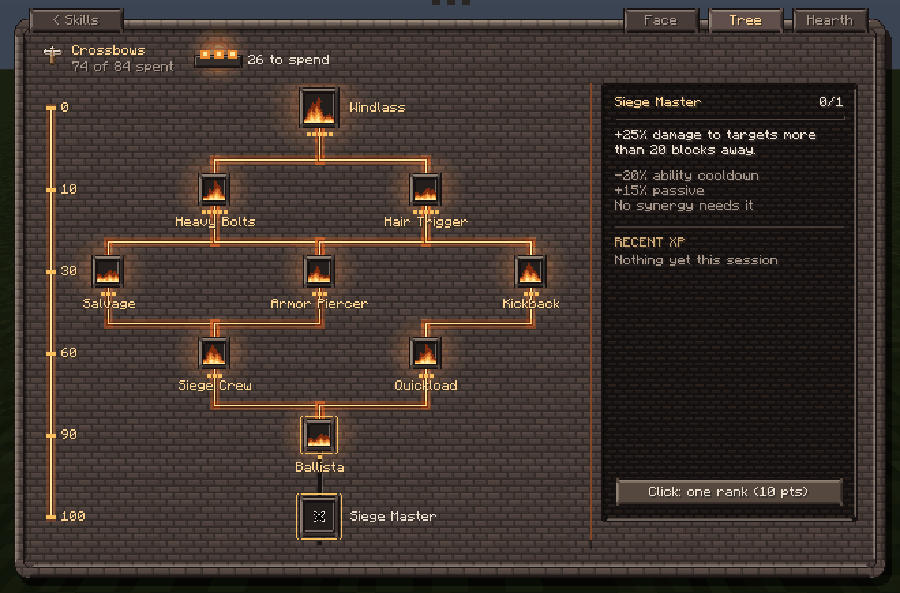

Every tree, node and synergy is listed in [docs/TREES.md](docs/TREES.md). The old panels stay
available under `ui.style = CLASSIC`.

## Waywheel and belt

Hold the ability key for the Waywheel, a stone wheel of the nine categories. It does not pause the
game. Flick to a rune and release on a skill to cast its ability. Click a token to open its Face.
Right-click pins up to three skills to a belt of sockets beside the hotbar. A tap of the key casts
the ability of the item in your hand.

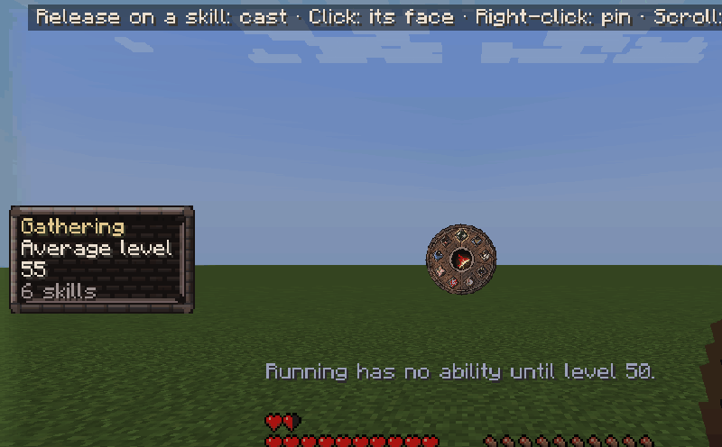

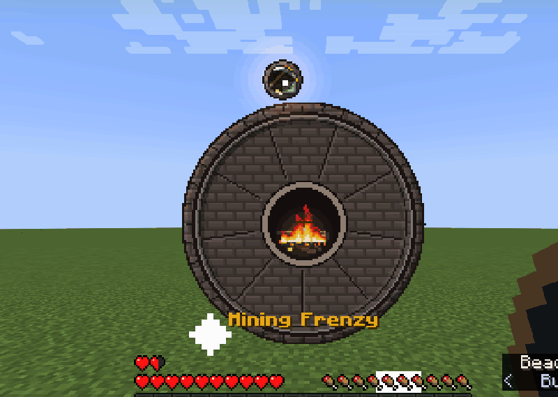

## Tempo

Repeat a skill's action and the XP multiplier climbs, up to +50%. Pixel flames rise along the HUD
bar, from embers to white-yellow, with the multiplier at the end. Gathering skills keep a chain
through 3 s of silence and climb +2% a step.

Fights have their own rule. The weapon skills keep a chain through 7 s and climb +5% a hit, so the
cap is 10 hits away. Courage, Charger, Guardian, Tactician and Blocking ride your live weapon chain.
A vanilla jump crit doubles the window of the next pause and flares the flames white.

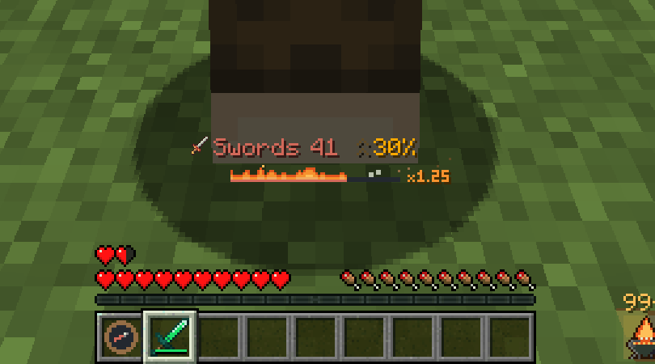

## Mastery stars and riders

After level 100 a skill's XP fills an overflow bar that earns up to five gold stars. Each star
powers that skill's Mastery rider, a bonus on its signature move. Swords echo the slash, Archery
arrows ricochet, Axes whirl, Engineering pulls loot in with a tractor beam. A rider fires only when
the signature lands and never chains. A death cuts the bar but never takes a star.

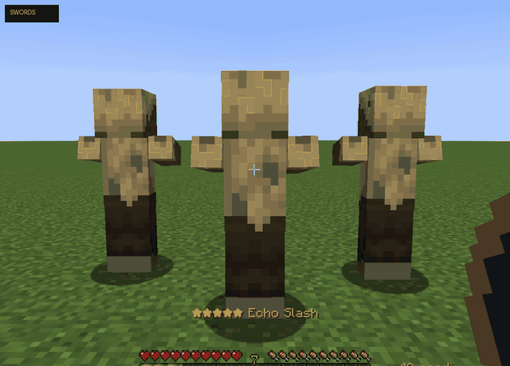

## Expertise

One more tree, across every skill. You get one point per 100 skill levels summed over all skills
and one per 5 Mastery stars, 70 in all. Thirteen nodes give XP, passives by category, signature
chance and power, and ability duration and cooldown. One player can fill all of it. A respec is
free at your own lit Hearth. Details: [docs/EXPERTISE-SPEC.md](docs/EXPERTISE-SPEC.md).

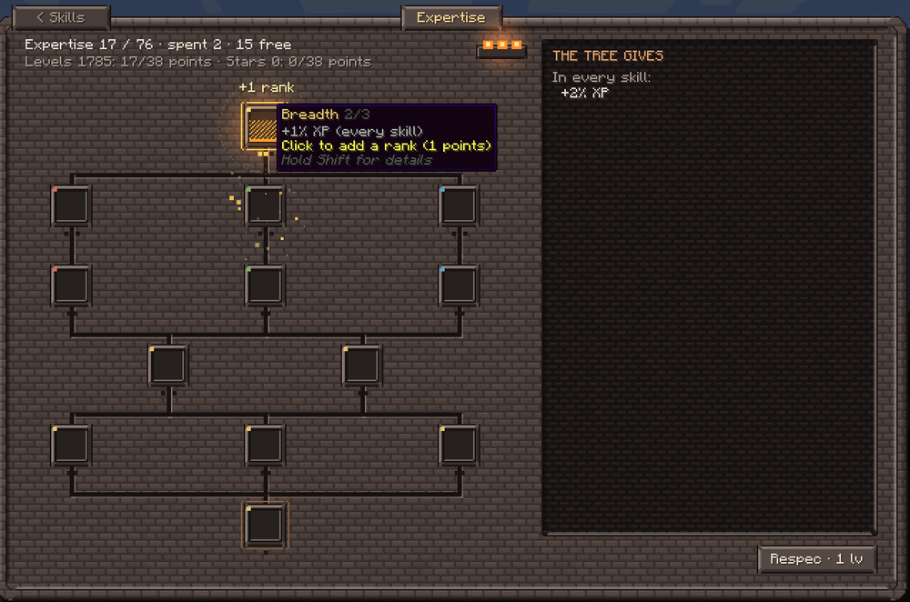

## Synergies

Two trees that work together wake a synergy. Every skill takes part in 9 to 11 of them. Most are
numeric boosts, and about thirty change how a pair plays (Falling Hammer, Pavise, Dragonbolt,
Lifeguard, Moon Garden). A synergy that wakes slams onto the screen once, then waits in a small
counter by the hotbar.

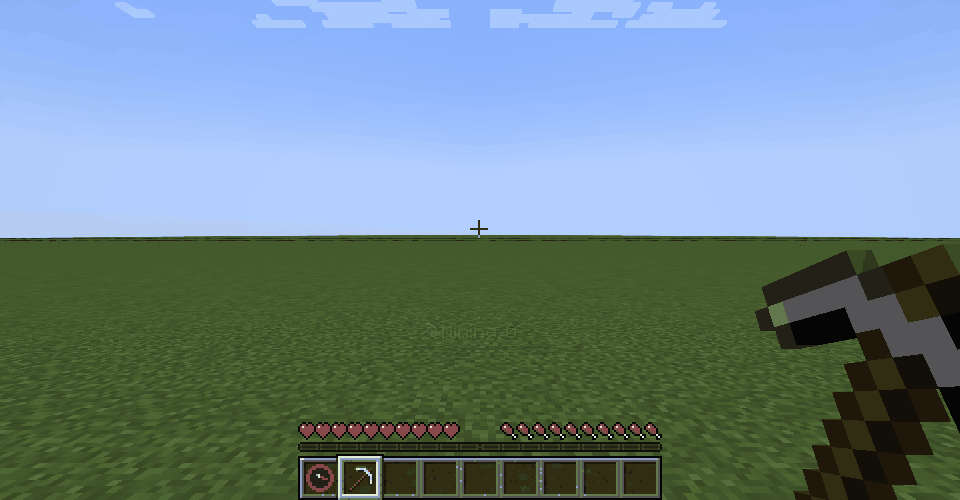

## The Hearth and Homebuilder

Light a campfire on a stone platform with flint and steel and it becomes your group's Hearth. It
grows through six stages. Each stage is a layer built around the fire to one of eight designs plus
an offering. XP earned near the Hearth charges five pools whose boons go to whoever warmed up by
the fire. A furnished home earns the strongest boons, and a finished one draws sieges.

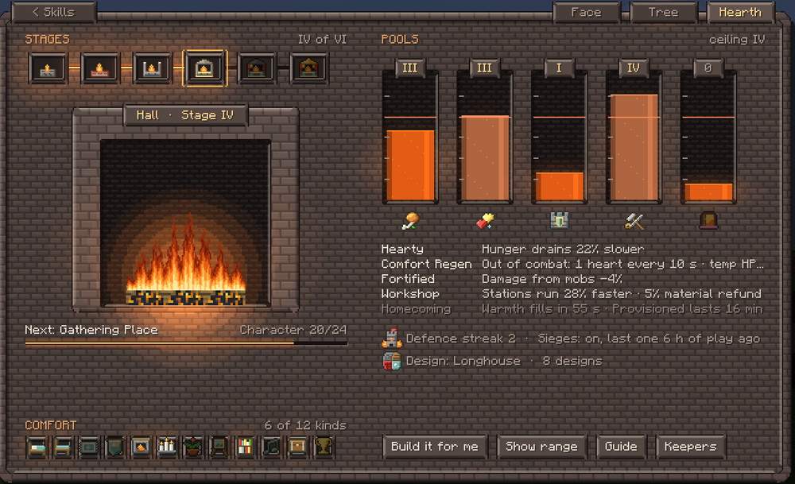

- **Eight designs.** Longhouse, Forge, Shrine, Demonic, Gothic, Girly, Overgrown Ruin and Frost
  Lodge. The guide previews each stage in 3D, and a build guide shows the next stage as ghost
  blocks (through Patchouli's visualizer when Patchouli is installed).
- **Build it for me.** The Hearth sets the next stage one block a minute from the packs and chests
  in range. You choose every block on a plan screen. It pays no XP and never touches your own
  blocks.
- **Homebuilder** is a skill of its own. It earns a share of what you do at home, gives speed,
  reach and an item magnet there, and grows the Hearth's range from 24 to 64 blocks.
- **Campfire page.** An empty hand on a plain campfire shows what stage I wants: the offering, the
  build, the empty pools and the build guide.

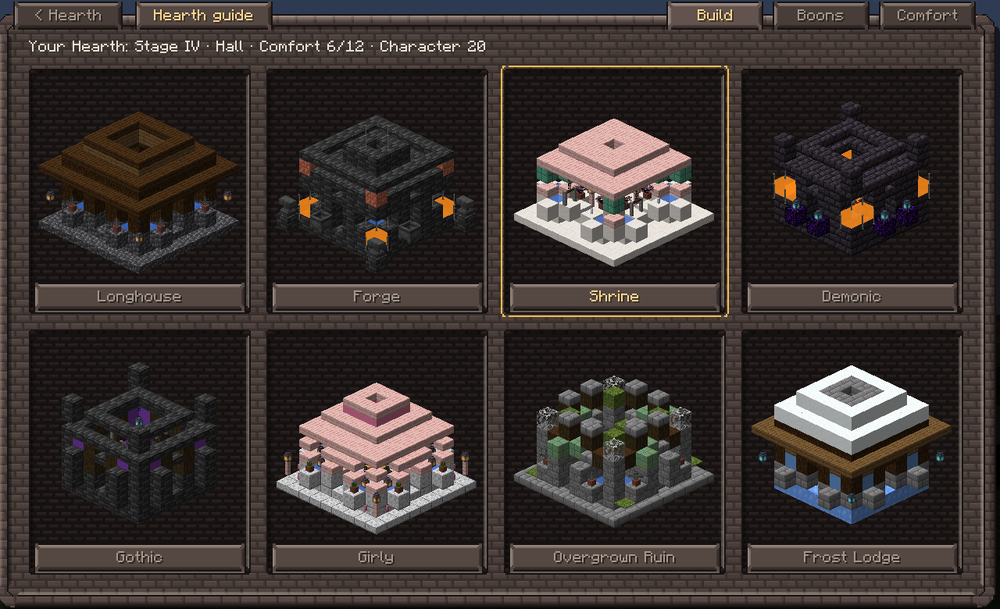

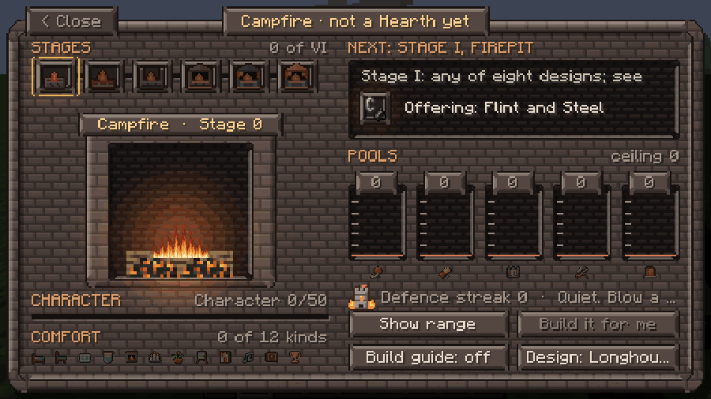

## Juice

Small effects make progress visible. Each one has its own client switch, and Distortion Effects at
0% (or `ui.juicyFeedback = false`) stops the movement while it keeps the numbers.

- **HUD flights.** XP dots fly into the skill bar. Bonus loot flies to its hotbar slot. On a
  level-up a coin flies from the bar into the coin brazier right of the hotbar.
- **Coin brazier and ready markers.** The brazier says how many talent ranks you can take now.
  The dial, the slate, the Face and the tree mark the same ranks, and a toast tells you when one
  becomes ready.
- **Milestones.** Levels 10, 25, 50, 75 and 100 get a banner and a firework.
- **Records.** Each skill keeps four personal bests, such as XP per minute and the longest Tempo
  chain. A new best gets a toast.
- **Today's Haul.** A bed shows a Today's Haul button. The card counts up what you earned since
  the last haul and stamps a rating.
- **Co-op streams.** A partner's XP streams from them into your bar when you earn together, and
  their faces sit in a row of pips.
- **HUD stack.** Up to three other skills that earn XP get a small row above the main line, with
  their own bars and level-ups.

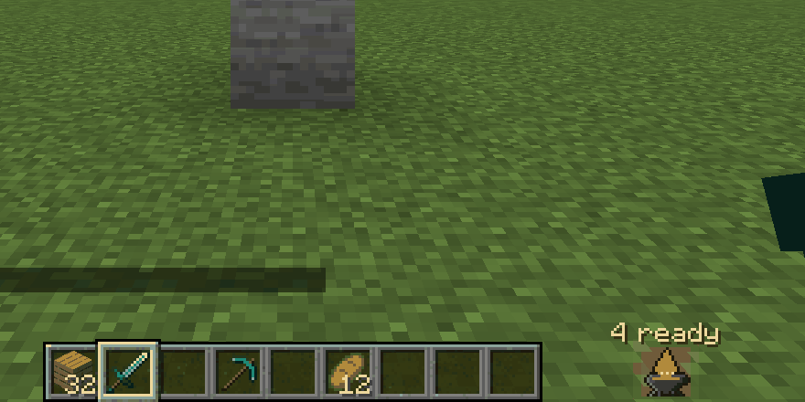

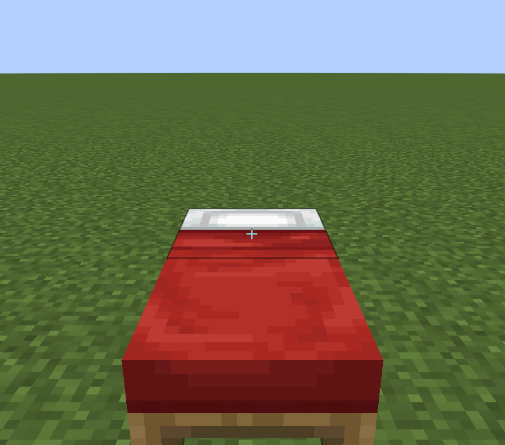

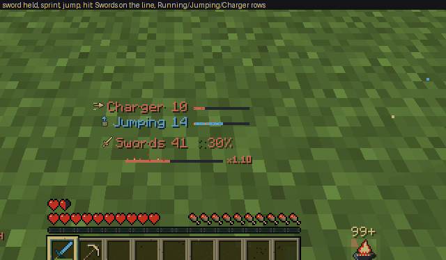

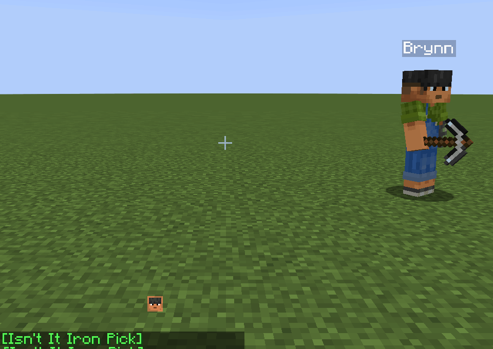

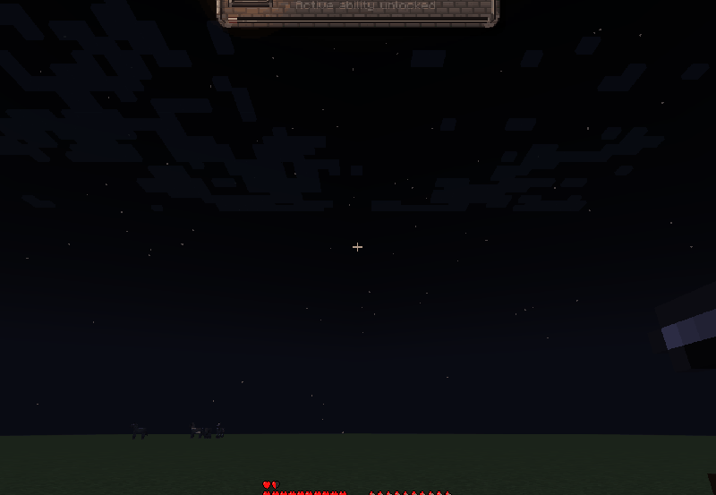


## Jade

With [Jade](https://modrinth.com/mod/jade) installed, a block or a mob shows what it would pay you
with the item in your hand, and a Hearth shows its state. The line is one short row: the skill's
icon and the XP. Another player shows their title, best skills and what you gain together. Five
toggles sit under "Proficiency" in Jade's plugin settings.

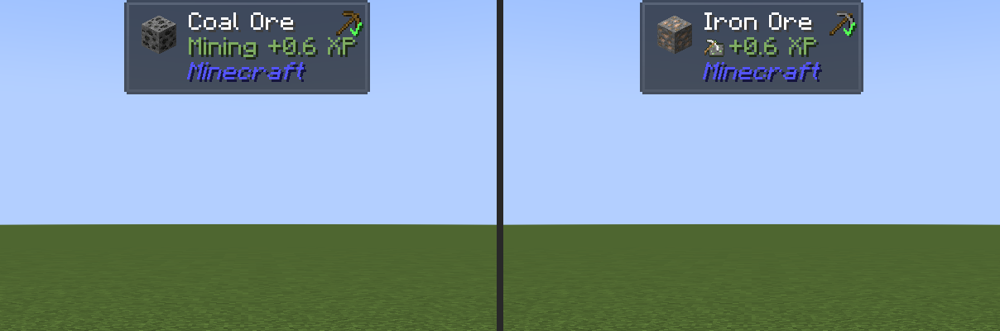

## Material tooltips

An item's tooltip lists the talent nodes you can open now that want it as a material, and how many
more you need. Shift adds the nodes that open later.

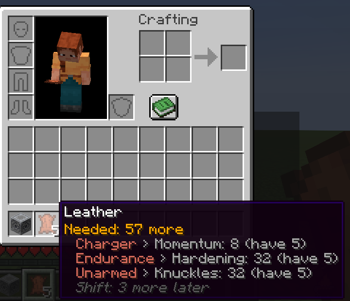

## Install

Put the jar for your loader in the `mods/` folder of the server and of every client. The mod
registers items, so a client without it cannot join a server that has it. Never leave two
Proficiency jars in one `mods/` folder.

| Loader | Required | Optional |
|---|---|---|
| NeoForge 1.21.1 | nothing | Jade, Patchouli |
| Fabric 1.21.1 | Fabric API, Forge Config API Port | Jade, Patchouli |
| Forge 1.20.1 | nothing | Jade, Patchouli, Xaero's World Map |

The network protocol is 13 on NeoForge and Fabric and 15 on Forge 1.20.1. Update the server, the
clients and any modpack together.

Default keys on NeoForge and Fabric: **K** opens the Skillstone and **G** casts an ability (hold
it for the Waywheel). On Forge 1.20.1 the keys are **I** and **`** (backtick). All of them can be
rebound under Controls.

## Config

`config/proficiency-client.toml` is per player. Mods > Proficiency > Config opens it in game.

| Key | Default | What it does |
|---|---|---|
| `ui.style` | `MODERN` | `MODERN` is the Skillstone and the Waywheel, `CLASSIC` the old panels |
| `ui.juicyFeedback` | true | Click feedback and movement in every effect |
| `ui.unlockSlam`, `ui.synergySlam`, `ui.milestoneCeremonies` | true | The three big moments |
| `ui.pointCoin`, `ui.bonusFlight`, `ui.restedPour` | true | The HUD flights |
| `ui.hudStack` | true | Rows for other skills that earn XP |
| `ui.readyToasts`, `ui.recordToasts` | true | Ready-rank and personal-best toasts |
| `ui.haulCard`, `ui.coopStreams` | true | Today's Haul and co-op streams |
| `ui.materialTooltips` | true | Talent nodes in item tooltips |
| `ui.skillIcons` | true | Skill icons instead of names in short lines, Jade included |
| `ui.tempoCritFlare`, `hud.showTempo` | true | The Tempo flames and the crit flare |
| `tooltip.alwaysDetailed` | false | Always show the Shift layer of tooltips |

`config/proficiency-server.toml` is created on the server's first start. Its main sections:

| Section | What it tunes |
|---|---|
| `progression` | XP rate, the level curve, Mastery stars, the kill bonus, `aoeXpShare` for area tools |
| `tempo` | The chain window and step; `tempo.combat` for the weapon skills |
| `survival` | The survival bonus (+1% XP per active hour alive, up to +50%) |
| `rested` | Rested XP and teaching |
| `company` | Mentor and group bonuses, co-op streams, the Jade player line |
| `records`, `haul`, `telemetry` | Personal records, Today's Haul, balance telemetry |
| `hearth`, `homebuilder` | The Hearth's range and sieges, Homebuilder's share and milestones |

Levels cost `8 + 2 * L^1.35` XP by default, about 44,000 XP from 0 to 100. A death wipes the
survival bonus and the progress toward each next level, never a level or a talent.

## Compatibility

Nothing is a hard dependency beyond the loader's own. With these mods installed, Proficiency picks
them up:

- Area tools (hammers, excavators, paxels, vein miners) pay full XP for the block you aimed at and
  10% for each other block of the swing.
- Create, Applied Energistics 2 and storage mods count for Engineering, Ars Nouveau for
  Spellcasting, Farmer's Delight for Cooking.
- Twilight Forest, the Aether and boss mods count for Beastslaying. Furniture mods such as
  Supplementaries and Chipped count for Decorating.
- Falling Tree makes Timber stand down, and Right Click Harvest pays Farming.
- Patchouli draws the Hearth build guide. Jade shows XP and Hearth state. Xaero's World Map shows
  Hearth ranges on Forge 1.20.1.
- Twelve languages: English, Polish, Simplified Chinese, Russian, Brazilian Portuguese, Spanish,
  German, French, Japanese, Korean, Turkish and Ukrainian.

Placed blocks, spawn-egg and spawner mobs, unripe crops, dummies and fake players pay nothing or
little, so a farm cannot level a skill.

## Tuning XP with a datapack

Every number that decides what an action pays is data. Put a file at
`data/<namespace>/proficiency/xp_sources/<name>.json` in any datapack (`world/datapacks/` on a
server) and run `/reload`. Only the server reads these files. The mod's own rules are the file
`data/proficiency/proficiency/xp_sources/defaults.json` inside the jar, and with no datapack the
game pays exactly what 1.2.0 paid.

A file is a JSON object with one array of rules per domain: `break`, `brush`, `place`, `craft`,
`cast`, `kill`, `kill_bonus`, `boss`, `structure`, `biome`, `dimension` and `first_time`. A rule names what
it matches (`"match"`: an id, a `#tag`, `mymod:*` or `*`), the `skill` (or `"none"` to pay
nothing) and the `xp`, a number or `{ "base", "per_hardness", "per_health", "min", "max" }`. The
highest `priority` wins, then the more specific match, then the rule loaded later. A bad file or
rule is logged and skipped, never a crash.

```json
{
  "break": [
    { "match": "mymod:ruby_ore", "skill": "mining", "tool": "pickaxe",
      "xp": { "base": 2.0, "per_hardness": 0.5, "max": 8.0 } },
    { "match": "#mymod:orchard_logs", "skill": "woodcutting", "xp": 1.5 },
    { "match": "mymod:rice", "skill": "farming", "xp": 1.0, "flags": ["crop"] },
    { "match": "minecraft:bookshelf", "skill": "none" }
  ],
  "place": [
    { "match": "mymod:*", "exclude": { "ids": ["mymod:steam_engine"] },
      "skill": "decorating", "xp": 1.0, "flags": ["decor"] },
    { "match": "mymod:steam_engine", "skill": "engineering", "xp": 3.0, "flags": ["machine"] }
  ],
  "kill": [
    { "match": "mymod:pet_dog", "skill": "none" }
  ],
  "kill_bonus": [
    { "match": "mymod:titan", "xp": { "base": 6.0, "per_health": 0.02, "max": 40.0 } }
  ],
  "boss": [
    { "match": "mymod:titan", "boss": true }
  ],
  "structure": [
    { "match": "mymod:sunken_temple", "xp": 80, "flags": ["grand"] }
  ],
  "biome": [
    { "match": "mymod:glow_forest", "xp": 40 }
  ],
  "first_time": [
    { "match": "mymod:flawless_gem_block", "kind": "block", "multiplier": 4.0 }
  ]
}
```

`/proficiency xpsources <id>` shows which rule won for an id and why the others lost.
`/proficiency xpaudit <mod>` lists what a mod adds that pays nothing or the wrong skill. The
Reclamation modpack's datapack is an example: `forge-1.20.1/packs/reclamation/datapack/`.

The held-block ability key on a client works out the build skill from the shipped defaults, because
clients never receive the datapack. That changes only which ability a held block fires, never the XP.

## Build

One tree builds the three jars. `core/` is pure Java shared by every jar, `common/` is the
Minecraft 1.21.1 code that NeoForge and Fabric share, and `neoforge/`, `fabric/` and
`forge-1.20.1/` hold what each loader needs.

```sh
./gradlew assemble
```

The jars land in `neoforge/build/libs/`, `fabric/build/libs/` and `forge-1.20.1/build/libs/`.
`tools/check-all.sh` builds all three and runs every unit test and the three GameTest suites. Java
21 is needed, and the Forge 1.20.1 project also needs a Java 17 that Gradle can find. The branches
`fabric-1.21.1` and `forge-1.20.1` hold the old per-loader releases up to 1.2.0 and are frozen.

## License

MIT, see [LICENSE](LICENSE).
